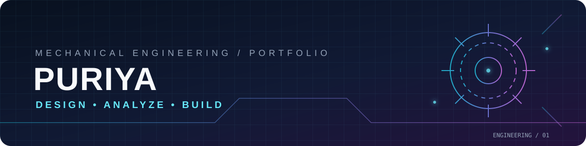

 

 

---

## `01 / About Me`

I'm **Pouria**, a Mechanical Engineering student at **Sharif University of Technology**, interested in turning engineering concepts into practical designs.

- ⚙️ Interested in mechanical design, machine elements, and industrial drafting.
- 📐 Working with 3D modeling, assemblies, and engineering drawings.
- 📊 Learning numerical methods and engineering computation with MATLAB.
- 🧩 Exploring simulation and analysis tools.
- 🚀 Always learning, building, and improving.

---

## `02 / Engineering Toolkit`

| Area | Tools & Skills |
|:--|:--|
| **CAD & Drafting** | SolidWorks · AutoCAD · 3D Modeling · Assembly · Technical Drawing |
| **Engineering Computing** | MATLAB · Numerical Methods |
| **Simulation** | ANSYS · Adams |
| **Mechanical Design** | Machine Elements · Strength of Materials · Design Calculations |
| **Programming** | Python · MATLAB |

  
  
  
  
  

---

## `03 / Selected Engineering Work`

A selection of topics and design exercises from my mechanical engineering coursework:

- **Gearbox Design & Assembly** — gear-train design, component modeling, and assembly.
- **Shaft Design** — mechanical sizing and strength calculations.
- **Spring Design** — design calculations and component sizing.
- **Bolted & Welded Joints** — joint design and engineering checks.
- **Mechanical Vibrations** — modeling and solving vibration problems.
- **Numerical Methods** — implementing numerical solution methods in MATLAB.

> Project repositories and technical documentation will be added as I publish and organize each project.

---

## `04 / GitHub Activity`

 

---

## `05 / Contribution Snake`

  

---

## `06 / Connect`

<!-- Add your LinkedIn, email, or portfolio links here when ready. -->

**Thanks for stopping by!**

Engineering is where curiosity meets creation.

